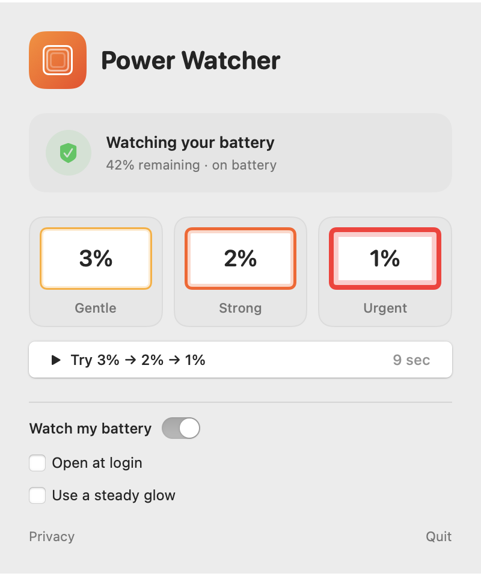

# Power Watcher

[](https://github.com/kovyrin/power-watcher/actions/workflows/ci.yml)
[](LICENSE)

A tiny macOS menu-bar app for the moment when you're deep in work and your
charger is right there, but your battery is about to give up.

Power Watcher adds a pulsing glow around your display at **3% battery**. It gets
wider and brighter at **2%**, then turns an insistent red at **1%**. The center
stays clear, and clicks and typing pass through normally. Plug in, and the glow
disappears.



## Features

- Amber at 3%, orange at 2%, red at 1% or below.
- Click-through overlays on each connected display.
- Configured to follow Spaces, full-screen apps, and Stage Manager.
- Six-second individual previews and a nine-second sequence.
- Optional steady glow; respects macOS Reduce Motion.
- Optional launch at login, with consent through macOS.
- Native SwiftUI, AppKit, IOKit, and Core Animation; no runtime dependencies.
- No accounts, ads, analytics, or background networking. See [Privacy](PRIVACY.md).

## Requirements

- macOS 14 Sonoma or later; Apple silicon or Intel.
- To build: Xcode 16 or later with Swift 6 and Command Line Tools.
- To lint documentation: Node.js 22.22+, 24.15+, or 26+ and npm (CI uses 26).

## Install from source

There is no signed public binary or App Store release yet.

```sh
git clone https://github.com/kovyrin/power-watcher.git
cd power-watcher
make app
open "dist/Power Watcher.app"
```

For daily use, move the app to Applications, open it there, then enable **Open at
login**. Keep it in that location after enabling the login item. Click the
shield-and-bolt menu-bar icon for controls; right-click for Open and Quit. Try
the preview cards without draining your battery.

Source builds are signed ad hoc for local development and are not notarized.
`make app` targets the current architecture; `make universal` builds for both
Apple silicon and Intel.

## Development

```sh
npm ci
make check
make smoke
```

`make check` runs unit tests, Markdown lint, shell syntax checks, and plist
validation. `make smoke` runs integration checks in a macOS GUI session, using
temporary preferences and simulated battery states. It never changes login items
and saves visual artifacts in `.build/self-check/`.

Open `PowerWatcher.xcodeproj` for the sandboxed app target and shared scheme.
The Swift package contains the app, pure battery policy module, and policy tests.
Both builds use the same source; no external Swift packages are downloaded.
See [Architecture](docs/ARCHITECTURE.md).

| Command | Result |
| --- | --- |
| `make app` | Local development app in `dist/` |
| `make universal` | Development app for arm64 and x86_64 |
| `make test` | Battery policy unit tests |
| `make lint` | Markdown, shell, and plist checks |
| `make smoke` | GUI integration checks and PNG artifacts |
| `make package` | Development ZIP and SHA-256 checksum |
| `make icons` | Regenerate original app icon artwork |
| `./scripts/archive.sh --unsigned` | Local Xcode archive check |

## Warning behavior

| Battery | Color | Inward fade | Pulse cycle | Edge opacity |
| --- | --- | --- | --- | --- |
| 3% | Amber | 20 points | 3.2 seconds | 25–80% |
| 2% | Orange | 36 points | 2.5 seconds | 45–95% |
| 1% or below | Red | 56 points | 1.8 seconds | 70–100% |

The glow reaches full transparency at the inner edge of each band. Widths are in
macOS points; physical pixels depend on display scaling. A preview never reduces
a real warning's urgency.

Only the internal Mac battery is monitored. External power suppresses warnings
even when charging is paused or the battery is full. Updates use IOKit
notifications, a wake refresh, and a 30-second fallback. Fractional percentages
round down conservatively. Core Animation runs the pulse without a frame timer.

**Limitations:** battery estimates and shutdown timing vary. A Mac can sleep
before reporting 1%; this app cannot prevent shutdown. Actual critical-battery
delivery, display changes, and full-screen behavior need manual validation on
your setup. Simulated checks do not prove them. See [Releasing](docs/RELEASING.md)
for the Mac App Store preparation and hardware checklist.
Current verification is recorded in [Pre-release validation](docs/VALIDATION.md).

## Contributing and support

Bug reports and focused pull requests are welcome. Start with
[Contributing](CONTRIBUTING.md), [Support](SUPPORT.md), and our
[Code of Conduct](CODE_OF_CONDUCT.md). Report vulnerabilities privately using
[Security](SECURITY.md). See [Changelog](CHANGELOG.md) for release notes.

## License

[MIT](LICENSE), copyright © 2026 Oleksiy Kovyrin. Original app icon artwork uses
the same license. System interface symbols remain Apple's assets and are not
included as app icon artwork.
