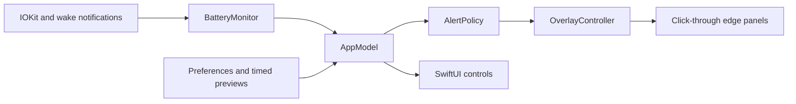

# Architecture

Power Watcher uses only Apple's system frameworks at runtime.

## Modules and state

- `PowerWatcherCore`: battery values, escalation styles, and pure alert policy.
- `AppModel`: observable main-actor state, preferences, and timed previews.
- `ControlsView`: the compact SwiftUI menu-bar interface.
- `BatteryMonitor`: IOKit power notifications on the main run loop, internal
  battery filtering, and a tolerant 30-second fallback timer.
- `OverlayController`: creates one nonactivating `EdgePanel` per display while
  a warning or preview is active. Four gradient layers and Core Animation create
  each glow.
- `SelfCheck`: opt-in checks with isolated preferences and local artifacts.
  Documentation screenshots use a simulated 42% battery reading.

The most urgent live/preview state wins. External power clears warnings, and
connecting it cancels previews. Preview expiry restores live monitoring. Sleep
hides overlays and cancels previews; wake refreshes the battery and panels.
Display changes rebuild panels.

## Windows and animation

Panels cannot become key or main windows and ignore mouse events. Public AppKit
collection behaviors let them join Spaces and other apps' full-screen/Stage
Manager sets. Their center is fully transparent. Warnings never request focus or
show modal dialogs.

Opacity varies smoothly without reaching zero; Reduce Motion makes it steady.
Core Animation handles the pulse without an app-driven frame timer. No overlay
windows exist at rest.

## Build paths

The Swift package provides fast tests and unsandboxed ad-hoc development builds.
The checked-in Xcode project builds a sandboxed app using the same local package's
`PowerWatcherCore` library, icon assets, and privacy manifest. The Xcode archive
is the starting point for an App Store submission. See [Releasing](RELEASING.md).

## Apple API references

- [Power-source notifications](https://developer.apple.com/documentation/iokit/1523868-iopsnotificationcreaterunloopsou)
- [Mouse-event passthrough](https://developer.apple.com/documentation/appkit/nswindow/ignoresmouseevents)
- [Full-screen and Stage Manager behavior](https://developer.apple.com/documentation/appkit/nswindow/collectionbehavior-swift.struct/canjoinallapplications)
- [Launch at login](https://developer.apple.com/documentation/servicemanagement/smappservice/mainapp)
